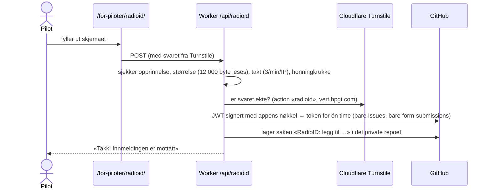

# Arkitektur

Hvordan hpgt.com er satt sammen, så flere enn én person kan forstå, drifte og videreutvikle det. Daglig drift, kontoer
og rutiner står i [operations.md](operations.md). Sikkerhetstiltakene står i [SECURITY.md](../SECURITY.md).

## Kort fortalt

- **Ingen server, ingen database.** Nettstedet er ferdige HTML-filer bygd fra tekstfiler (Markdown og JSON) i dette
  repoet. Alt innhold og all historikk ligger i Git.
- **Medlemmene skriver i Pages CMS** (app.pagescms.org), en nettbasert editor som lagrer rett til repoet. De trenger
  ikke GitHub-konto.
- **GitHub Actions bygger og publiserer** hver gang `main` endres: oversetter ny tekst til engelsk, bygger nettstedet og
  laster det opp til Cloudflare.
- **Cloudflare leverer nettstedet** (Workers static assets). Den eneste serverkoden er de to skjemaene (RadioID og
  «Meld feil»).
- **Ingen sporing, ingen informasjonskapsler, ingen tredjepartsskript** (unntatt Turnstile på skjemasidene).

## Oversikt

Redaktører lagrer i Pages CMS, som committer til repoet. Administratorer endrer med pull request. Hver push til `main`
starter GitHub Actions, som oversetter med Anthropic (OIDC, ingen lagret nøkkel) og publiserer til Workeren `hpgt-web`
med et token som bare gjelder den. Besøkende når Workeren gjennom DNS hos Cloudflare. Skjemaene sjekkes med Turnstile
og blir saker i det private repoet `form-submissions` gjennom GitHub-appen «HPGT Web Forms».

Flystedsguiden **flysteder.hpgt.com** er et eget nettsted i repoet
[hpgt-com/flying-sites](https://github.com/hpgt-com/flying-sites), med egen dokumentasjon (`docs/architecture.md` og
`docs/operations.md` der). Klubbsiden lenker dit, men de deler ingen kode.

## Fra «Lagre» til publisert side

Når en redaktør lagrer, committer Pages CMS til `main`, og «Bygg og publiser» starter. `translate` henter de forrige
oversettelsene og oversetter bare ny eller endret tekst. `build` bygger og kontrollerer nettstedet. `publish` setter inn
skjemaenes ID-er og publiserer med Wrangler. Det tar 2–3 minutter, og feiler et steg, blir forrige versjon stående.

De tre jobbene er skilt fra hverandre med vilje (`.github/workflows/deploy.yml`). Før dem kjører jobben `guard`, som
stopper publiseringen hvis en commit uten pull request har endret noe annet enn innholdet (se
[operations.md](operations.md#når-publiseringen-feiler)).

| Jobb | Har tilgang til | Kjører kode fra repoet? |
|---|---|---|
| `translate` | En kortvarig innlogging hos Anthropic (miljøet `translation`) | Bare oversettelsesskriptet, ikke pakkene til nettstedet |
| `build` | Ingen hemmeligheter | Ja (npm-pakker og bygget) |
| `publish` | Cloudflare-tokenet (miljøet `production`) | Nei, bare Wrangler, installert fra `deploy/package-lock.json` uten installasjonsskript |

Pull requests (også fra administratorer) bygges og kontrolleres av `pr-check.yml`, `security.yml` og
`code-scanning.yml` før de kan merges, men publiseres ikke.

## Innhold: hva som ligger hvor

| Innhold | Fil eller mappe | Redigeres i |
|---|---|---|
| Nyheter, referater, arrangementer | `src/content/posts/YEAR/*.md` | Pages CMS |
| Faste sider (For piloter, Klubben …) | `src/content/pages/*.md` | Pages CMS |
| Konkurranser | `src/content/pages/konkurranser/YEAR.md` | Pages CMS |
| Kurssider | `src/content/courses/*.md` | Pages CMS |
| Forsiden, styret, RadioID-registeret | `src/data/front-page.json`, `board.json`, `radio-id.json` | Pages CMS |
| Sponsorene i stripen «Støttet av» nederst på alle sidene (logo, lenke, start- og sluttdato). Logoene trimmes og skaleres i bygget (`scripts/resize-images.mjs`). Uten sponsorer vises ingen stripe | `src/data/sponsors.json`, logoene i `public/media/sponsors/` | Pages CMS |
| Standardbilder per kategori | `src/data/default-images.json` | Pages CMS |
| Bilder og PDF-er | `public/media/…` (se README-en) | Pages CMS (opplasting) |
| Menyer, innstillinger for nettstedet | `src/data/menu.json`, `site.json` | Bare pull request |
| Design | `src/design/` (`style.css`, maler), `src/components/` | Bare pull request |
| Videresending fra gamle adresser | `src/lib/redirects.mjs` (faste adresser, skrives som 301 i `dist/_redirects` av `scripts/redirects.mjs`), `public/_redirects` (regler med `*`) | Bare pull request |

Hvert felt kontrolleres av `src/content.config.ts`. En ugyldig verdi fra CMS-et stopper bygget i stedet for å publisere
en ødelagt side. Hvilke felt redaktørene ser, bestemmes av `.pages.yml`. Felt som ikke står der, fjernes når noen
lagrer, og derfor har noen felt `hidden: true`.

Mappene, datafilene og feltnavnene er engelske (for eksempel `posts`, `title`, `lead`, `event.location`), mens det
redaktørene ser, er norsk: hver samling og hvert felt i `.pages.yml` har en norsk `label` («Nyheter, referater og
arrangementer», «Ingress», «Arrangement (valgfritt)» …). Verdiene er norske, og filnavnene til innleggene og sidene
beholdes fordi de kan bestemme adressen. Av samme grunn heter mappa med konkurransesidene `konkurranser`: navnet gir
adressen `/klubben/konkurranser/ÅR/`.

Det Pages CMS kan lagre uten pull request (mappene i `src/content/`, `public/media/` og de fire datafilene over), står i
listen `TILLATT` i `guard`-jobben i `deploy.yml`. Får en av dem nytt navn, må listen endres i samme pull request.

## Engelsk versjon

Sidene i `PAGES` i `scripts/translate/translate.mjs` (kurs, for piloter, klubbsidene og så videre) oversettes automatisk
ved hver publisering. Uendret tekst gjenbrukes fra forrige publisering (`/en/oversettelser.json`), så bare nye eller
endrede avsnitt sendes til Anthropic. Engelske adresser (`/klubben/styret/` → `/en/club/board/`) står i
`src/lib/english-paths.mjs`, og faste tekster (menyer, knapper) i `src/lib/i18n.ts`.

Nøklene i oversettelsene (`/en/oversettelser.json`) bruker fortsatt de norske navnene fra før innholdsmodellen fikk
engelske navn, for eksempel `sider/kurs#ingress`, `innlegg/2019/navn#title` og `forside#veier.0.tittel`. Tabellen
`LEGACY` i `scripts/translate/translate.mjs` oversetter de nye mappe- og feltnavnene til de gamle, så oversettelsene
som allerede er publisert, brukes videre og ingenting oversettes på nytt bare fordi et navn er endret.

Nyheter og arrangementer oversettes også (`/en/news/`, `/en/events/`, og hvert innlegg på `/en/<address>/`), unntatt
møtereferater, som er formelle dokumenter for medlemmene og blir stående på norsk. Hvert engelske innlegg sier at det er
oversatt automatisk, og lenker til den norske originalen. Et innlegg uten oversettelse (referater, eller et der
oversettelsen feilet) står i de engelske listene med norsk tittel og «(in Norwegian)».

Feiler innloggingen hos Anthropic, publiseres nettstedet likevel, med de forrige oversettelsene.

Bildeadressene i den engelske teksten hentes alltid fra den norske (`scripts/translate/media-paths.mjs`,
[0008](decisions/0008-image-sizes-in-build.md)), så begge språk bruker samme fil, også når en eldre oversettelse brukes.

## Skjemaene (RadioID og «Meld feil»)

Piloten sender skjemaet med svaret fra Turnstile. Workeren sjekker opprinnelse, størrelse, takt og honningkrukke, og
får svaret bekreftet av Turnstile. Deretter bytter den en JWT signert med appens nøkkel mot et token for én time, lager
saken i det private repoet og svarer piloten.

Sakene ligger i det private repoet `hpgt-com/form-submissions`, fordi de inneholder navn, RadioID-er og kommentarer,
også ønsker om å bli fjernet. Den som vedlikeholder registeret, oppdaterer `radio-id.json` i Pages CMS (bare den ferdige
oppføringen publiseres) og lukker saken. Koden er `worker/index.js` og `worker/github-app.js`.

Det andre skjemaet, **«Meld feil»** (`/meld-feil/` og `/en/report-error/`, lenket fra bunnen av hver side), virker på
samme måte: `/api/meld-feil`, Turnstile-action `meldfeil`, og en sak med etiketten `feedback` i det samme private
repoet. Nye skjemaer bruker den samme Turnstile-widgeten med sin egen `action`.

## Sikkerhet i korte trekk

- **Minste tilgang overalt.** Hvert token kan bare gjøre det ene det er til: publisere én Worker, lage saker i ett
  repo, lese ett R2-arkiv. Ingen personlige tokens.
- **Ingen lagrede nøkler der det kan unngås.** Oversettelsen logger inn med GitHubs OIDC-token. Skjemaene får et nytt
  token for hver innsending.
- **Hemmeligheter bare i miljøer som bare `main` kan bruke** (GitHub) eller i Cloudflare, aldri i koden.
- **Alt går gjennom pull request** med påkrevde sjekker (bygg, avhengigheter, sikkerhet i arbeidsflytene, CodeQL).
- **Streng CSP** med `default-src 'none'` og uten `unsafe-inline`. Brudd rapporteres til `/api/csp-report`, og Trusted
  Types håndheves.

Detaljer: [SECURITY.md](../SECURITY.md).

## Oppbygning av repoet

| Mappe eller fil | Innhold |
|---|---|
| `.github/workflows/` | Bygg, publisering, PR-sjekker, sikkerhetsskanning |
| `.pages.yml` | Hva redaktørene ser i Pages CMS |
| `astro.config.mjs` | Astro-oppsett og videresendinger |
| `deploy/` | Den låste Wrangler-versjonen for publiseringsjobben |
| `docs/` | Denne dokumentasjonen |
| `public/` | Filer som publiseres som de er: bilder, skript, `_headers`, `_redirects`, `robots.txt` |
| `scripts/` | Oversettelse, miniatyrbilder for video, skalering av bilder og mindre utgaver for `srcset` ([0008](decisions/0008-image-sizes-in-build.md)), nettstedskart, WordPress-import (engangs) |
| `src/content/` | Innholdet (Markdown) |
| `src/data/` | Innhold og innstillinger (JSON) |
| `src/design/` | Designet «Fjord+» |
| `src/components/` | Gjenbrukbare deler |
| `src/lib/` | Hjelpefunksjoner (lenker, språk, seksjoner) |
| `src/pages/` | Adressene (Astro-ruter) |
| `test/` | Enhetstester for `worker/` og Markdown-oppsettet, og ende-til-ende-testene i `test/e2e/` (se «Testene» under) |
| `worker/` | Serverkoden for skjemaene |
| `wrangler.jsonc` | Cloudflare-oppsett |

## Testene

Alle kjører i jobben `build` i `pr-check.yml` for hver pull request, og lokalt med kommandoene i
[AGENTS.md](../AGENTS.md#kommandoer). Ingen av dem trenger nett.

| Test | Hva |
|---|---|
| `npm test` (`test/*.test.js`) | Enhetstester for `worker/` og overskriftene i Markdown (`src/lib/rehype-base.mjs`), uten nettleser |
| `node scripts/check-links.mjs` | Interne lenker og bilder i `dist/`, også adressene i `srcset` |
| `node scripts/check-accessibility.mjs` | axe i lys og mørk visning |
| `npm run check:budget` | Ytelsesbudsjettet per side |
| `npm run test:e2e` (`test/e2e/*.test.mjs`) | Ende-til-ende i Chromium mot den bygde siden |
| `wrangler deploy --dry-run` (fra `deploy/`) | Workeren og `dist/` pakkes av samme Wrangler som publiseringen, uten å publisere |
| Anthropic-SDK-en (`scripts/translate/`) | Lastes og lager en klient uten nøkkel, så en oppdatering som ikke virker, stopper |

Sammen fanger de det Dependabot kan ødelegge, så patch og minor av npm-pakkene merges automatisk
(`dependabot-automerge.yml`).

Ende-til-ende-testene bruker `scripts/serve-dist.mjs`, som serverer `dist/` slik Cloudflare gjør i drift:

- Hodene fra `_headers` brukes som hos Cloudflare: alle regler som passer adressen, i rekkefølge, med `! Navn` for å
  fjerne et hode og komma mellom verdiene når flere regler setter det samme hodet. Hodene settes på alle svar fra de
  statiske filene, også videresendinger og 404-siden, men ikke på svar fra Workeren.
- `_redirects`, `html_handling: "force-trailing-slash"` (307 fra `/x` til `/x/`) og `not_found_handling: "404-page"`
  fra `wrangler.jsonc`.
- `/api/*` går til den ekte Workeren (`worker/index.js`) med et stubbet miljø: `ALLOWED_ORIGIN` er serverens egen
  adresse, hastighetsgrensene slipper alt gjennom, og det finnes ingen Turnstile-hemmelighet eller GitHub-app. Workeren
  får ikke kontakte andre verter, så en gyldig innsending stopper ved menneskesjekken (403).

Testene sjekker sikkerhetshodene (CSP, at bare skjemasidene tillater Turnstile, HSTS, COOP, CORP, rapporteringen og
at Trusted Types håndheves), at sidene ikke har CSP-brudd eller skriptfeil i lys og mørk visning på PC og mobil,
skriptene i `public/assets/js/` (meny, tema, typefilter, bildevisning, galleriet for innsendte bilder, søk, innholdsfortegnelse, «Kopier lenke»),
skjemaene (honningkrukka, svaret fra Workeren, 405 og 403), 404-siden og videresendingene. `pages.test.mjs` henter
alle sidene i `sitemap.xml` på begge språk og sjekker status, språk (`lang`), tittel og én hovedoverskrift, at
språkvalget peker til sider som finnes, og at hreflang går begge veier. Nettleseren når ingen andre
verter: forespørsler dit avbrytes, og navneoppslag feiler. Det som ikke etterlignes: komprimering, ETag og 304,
hurtigbufferen og hodene Cloudflare selv legger til.

## Hvorfor disse valgene

Hvert valg er beskrevet som en ADR i [decisions/](decisions/README.md). Kort fortalt:

- **Et statisk nettsted**: ingenting å oppdatere eller angripe på en server, nesten gratis og raskt.
- **Astro**: kontrollerer innholdet, malene er vanlig HTML og JavaScript, og bygget tar sekunder.
- **Pages CMS**: det eneste CMS-et der medlemmer kan logge inn med e-post uten GitHub-konto, og der e-postbrukere bare
  kan endre innhold.
- **Cloudflare**: gratis for vår bruk, DNS og nettstedet på ett sted, og Turnstile uten sporing.
- **GitHub**: historikk, gjennomgang og automatisering på ett sted, gratis for offentlige repoer.
