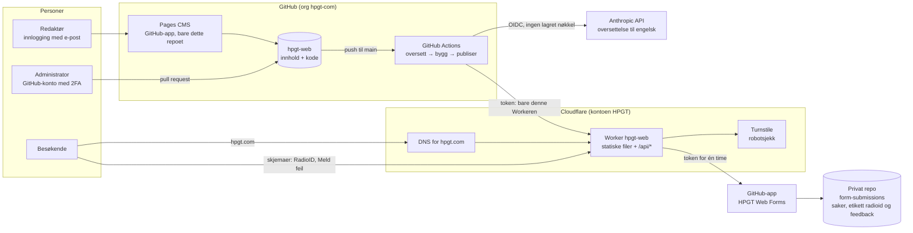
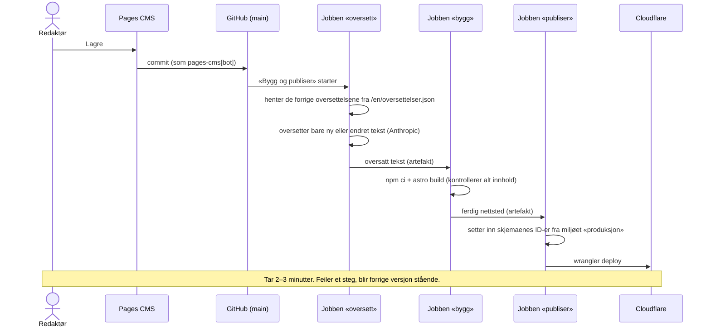
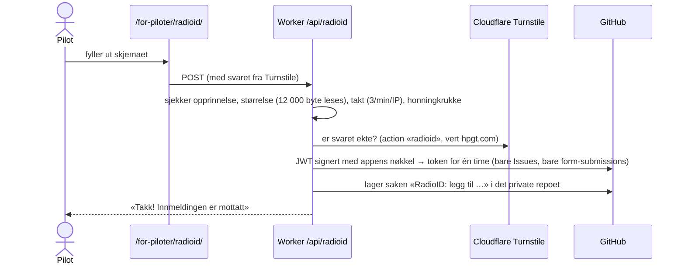

# Arkitektur

Hvordan hpgt.com er satt sammen, så flere enn én person kan forstå, drifte og videreutvikle det. Daglig drift, kontoer
og rutiner står i [operations.md](operations.md). Sikkerhetstiltakene står i [SECURITY.md](../SECURITY.md).

## Kort fortalt

- **Ingen server, ingen database.** Nettstedet er ferdige HTML-filer bygd fra tekstfiler (Markdown og JSON) i dette
  repoet. Alt innhold og all historikk ligger i Git.
- **Medlemmene skriver i Pages CMS** (app.pagescms.org), en nettbasert editor som lagrer rett til repoet. De trenger
  ikke GitHub-konto.
- **GitHub Actions bygger og publiserer** hver gang `main` endres: oversetter ny tekst til engelsk, bygger nettstedet og
  laster det opp til Cloudflare.
- **Cloudflare leverer nettstedet** (Workers static assets). Den eneste serverkoden er de to skjemaene (RadioID og
  «Meld feil»).
- **Ingen sporing, ingen informasjonskapsler, ingen tredjepartsskript** (unntatt Turnstile på skjemasidene).

## Oversikt

Redaktører lagrer i Pages CMS, som committer til repoet. Administratorer endrer med pull request. Hver push til `main`
starter GitHub Actions, som oversetter med Anthropic (OIDC, ingen lagret nøkkel) og publiserer til Workeren `hpgt-web`
med et token som bare gjelder den. Besøkende når Workeren gjennom DNS hos Cloudflare. Skjemaene sjekkes med Turnstile
og blir saker i det private repoet `form-submissions` gjennom GitHub-appen «HPGT Web Forms».

Flystedsguiden **flysteder.hpgt.com** er et eget nettsted i repoet
[hpgt-com/flying-sites](https://github.com/hpgt-com/flying-sites), med egen dokumentasjon (`docs/architecture.md` og
`docs/operations.md` der). Klubbsiden lenker dit, men de deler ingen kode.

## Fra «Lagre» til publisert side

Når en redaktør lagrer, committer Pages CMS til `main`, og «Bygg og publiser» starter. `oversett` henter de forrige
oversettelsene og oversetter bare ny eller endret tekst. `bygg` bygger og kontrollerer nettstedet. `publiser` setter inn
skjemaenes ID-er og publiserer med Wrangler. Det tar 2–3 minutter, og feiler et steg, blir forrige versjon stående.

De tre jobbene er skilt fra hverandre med vilje (`.github/workflows/deploy.yml`). Før dem kjører jobben `vakt`, som
stopper publiseringen hvis en commit uten pull request har endret noe annet enn innholdet (se
[operations.md](operations.md#når-publiseringen-feiler)).

| Jobb | Har tilgang til | Kjører kode fra repoet? |
|---|---|---|
| `oversett` | En kortvarig innlogging hos Anthropic (miljøet `oversetting`) | Bare oversettelsesskriptet, ikke pakkene til nettstedet |
| `bygg` | Ingen hemmeligheter | Ja (npm-pakker og bygget) |
| `publiser` | Cloudflare-tokenet (miljøet `produksjon`) | Nei, bare Wrangler, installert fra `deploy/package-lock.json` uten installasjonsskript |

Pull requests (også fra administratorer) bygges og kontrolleres av `pr-check.yml`, `security.yml` og
`code-scanning.yml` før de kan merges, men publiseres ikke.

## Innhold: hva som ligger hvor

| Innhold | Fil eller mappe | Redigeres i |
|---|---|---|
| Nyheter, referater, arrangementer | `src/content/innlegg/YEAR/*.md` | Pages CMS |
| Faste sider (For piloter, Klubben …) | `src/content/sider/*.md` | Pages CMS |
| Konkurranser | `src/content/sider/konkurranser/YEAR.md` | Pages CMS |
| Kurssider | `src/content/kurs/*.md` | Pages CMS |
| Forsiden, styret, RadioID-registeret | `src/data/forside.json`, `styret.json`, `radioid.json` | Pages CMS |
| Standardbilder per kategori | `src/data/standardbilder.json` | Pages CMS |
| Bilder og PDF-er | `public/media/…` (se README-en) | Pages CMS (opplasting) |
| Menyer, innstillinger for nettstedet | `src/data/meny.json`, `site.json` | Bare pull request |
| Design | `src/design/` (`style.css`, maler), `src/components/` | Bare pull request |
| Videresending fra gamle adresser | `astro.config.mjs`, `public/_redirects` | Bare pull request |

Hvert felt kontrolleres av `src/content.config.ts`. En ugyldig verdi fra CMS-et stopper bygget i stedet for å publisere
en ødelagt side. Hvilke felt redaktørene ser, bestemmes av `.pages.yml`. Felt som ikke står der, fjernes når noen
lagrer, og derfor har noen felt `hidden: true`.

## Engelsk versjon

Sidene i `SIDER` i `scripts/oversett/oversett.mjs` (kurs, for piloter, klubbsidene og så videre) oversettes automatisk
ved hver publisering. Uendret tekst gjenbrukes fra forrige publisering (`/en/oversettelser.json`), så bare nye eller
endrede avsnitt sendes til Anthropic. Engelske adresser (`/klubben/styret/` → `/en/club/board/`) står i
`src/lib/engelske-adresser.mjs`, og faste tekster (menyer, knapper) i `src/lib/i18n.ts`.

Nyheter og arrangementer oversettes også (`/en/news/`, `/en/events/`, og hvert innlegg på `/en/<address>/`), unntatt
møtereferater, som er formelle dokumenter for medlemmene og blir stående på norsk. Hvert engelske innlegg sier at det er
oversatt automatisk, og lenker til den norske originalen. Et innlegg uten oversettelse (referater, eller et der
oversettelsen feilet) står i de engelske listene med norsk tittel og «(in Norwegian)».

Feiler innloggingen hos Anthropic, publiseres nettstedet likevel, med de forrige oversettelsene.

## Skjemaene (RadioID og «Meld feil»)

Piloten sender skjemaet med svaret fra Turnstile. Workeren sjekker opprinnelse, størrelse, takt og honningkrukke, og
får svaret bekreftet av Turnstile. Deretter bytter den en JWT signert med appens nøkkel mot et token for én time, lager
saken i det private repoet og svarer piloten.

Sakene ligger i det private repoet `hpgt-com/form-submissions`, fordi de inneholder navn, RadioID-er og kommentarer,
også ønsker om å bli fjernet. Den som vedlikeholder registeret, oppdaterer `radioid.json` i Pages CMS (bare den ferdige
oppføringen publiseres) og lukker saken. Koden er `worker/index.js` og `worker/github-app.js`.

Det andre skjemaet, **«Meld feil»** (`/meld-feil/` og `/en/report-error/`, lenket fra bunnen av hver side), virker på
samme måte: `/api/meld-feil`, Turnstile-action `meldfeil`, og en sak med etiketten `feedback` i det samme private
repoet. Nye skjemaer bruker den samme Turnstile-widgeten med sin egen `action`.

## Sikkerhet i korte trekk

- **Minste tilgang overalt.** Hvert token kan bare gjøre det ene det er til: publisere én Worker, lage saker i ett
  repo, lese ett R2-arkiv. Ingen personlige tokens.
- **Ingen lagrede nøkler der det kan unngås.** Oversettelsen logger inn med GitHubs OIDC-token. Skjemaene får et nytt
  token for hver innsending.
- **Hemmeligheter bare i miljøer som bare `main` kan bruke** (GitHub) eller i Cloudflare, aldri i koden.
- **Alt går gjennom pull request** med påkrevde sjekker (bygg, avhengigheter, sikkerhet i arbeidsflytene, CodeQL).
- **Streng CSP** uten `unsafe-inline`, og ingen tredjepartsskript.

Detaljer: [SECURITY.md](../SECURITY.md).

## Oppbygning av repoet

| Mappe eller fil | Innhold |
|---|---|
| `.github/workflows/` | Bygg, publisering, PR-sjekker, sikkerhetsskanning |
| `.pages.yml` | Hva redaktørene ser i Pages CMS |
| `astro.config.mjs` | Astro-oppsett og videresendinger |
| `deploy/` | Den låste Wrangler-versjonen for publiseringsjobben |
| `docs/` | Denne dokumentasjonen |
| `public/` | Filer som publiseres som de er: bilder, skript, `_headers`, `_redirects`, `robots.txt` |
| `scripts/` | Oversettelse, miniatyrbilder for video, skalering av bilder, nettstedskart, WordPress-import (engangs) |
| `settings/` | Innstillinger for organisasjonen og repoet som ikke kan ligge i repoet (settes av en eier av organisasjonen) |
| `src/content/` | Innholdet (Markdown) |
| `src/data/` | Innhold og innstillinger (JSON) |
| `src/design/` | Designet «Fjord+» |
| `src/components/` | Gjenbrukbare deler |
| `src/lib/` | Hjelpefunksjoner (lenker, språk, seksjoner) |
| `src/pages/` | Adressene (Astro-ruter) |
| `test/` | Enhetstester for `worker/` |
| `worker/` | Serverkoden for skjemaene |
| `wrangler.jsonc` | Cloudflare-oppsett |

## Hvorfor disse valgene

Hvert valg er beskrevet som en ADR i [decisions/](decisions/README.md). Kort fortalt:

- **Et statisk nettsted**: ingenting å oppdatere eller angripe på en server, nesten gratis og raskt.
- **Astro**: kontrollerer innholdet, malene er vanlig HTML og JavaScript, og bygget tar sekunder.
- **Pages CMS**: det eneste CMS-et der medlemmer kan logge inn med e-post uten GitHub-konto, og der e-postbrukere bare
  kan endre innhold.
- **Cloudflare**: gratis for vår bruk, DNS og nettstedet på ett sted, og Turnstile uten sporing.
- **GitHub**: historikk, gjennomgang og automatisering på ett sted, gratis for offentlige repoer.
