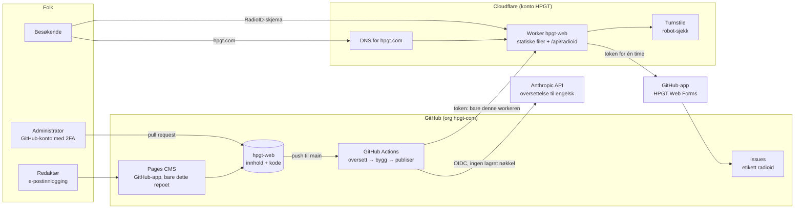
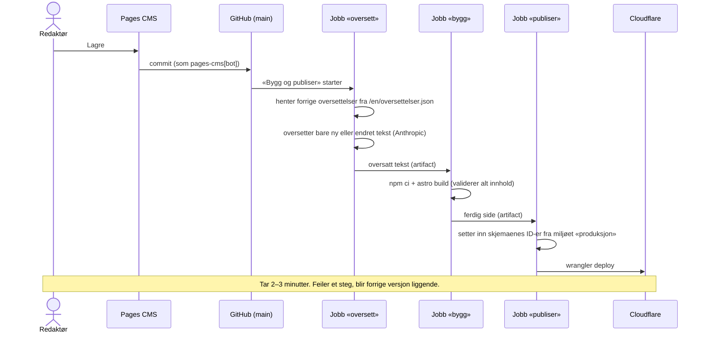
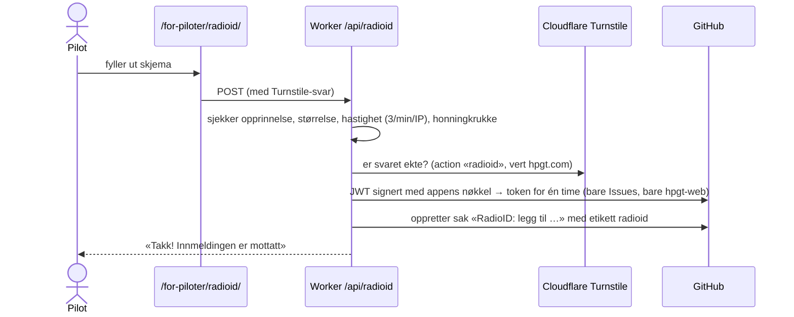

# Arkitektur: slik er hpgt.com bygget

Dette dokumentet forklarer hvordan nettsiden henger sammen, slik at flere enn én person kan forstå, drifte og
videreutvikle den. Daglig drift, kontoer og rutiner står i [operations.md](operations.md). Sikkerhetstiltakene står i
[SECURITY.md](../SECURITY.md).

## Kort fortalt

- **Ingen server, ingen database.** Siden er ferdige HTML-filer som bygges fra tekstfiler (Markdown og JSON) i dette
  repoet. Alt innhold og all historikk ligger i Git.
- **Medlemmer skriver i Pages CMS** (app.pagescms.org), et nettbasert skriveverktøy som lagrer rett i repoet. De trenger
  ingen GitHub-konto.
- **GitHub Actions bygger og publiserer** hver gang `main` endres: oversetter ny tekst til engelsk, bygger siden og
  laster den opp til Cloudflare.
- **Cloudflare viser siden** (Workers static assets). Den eneste serverkoden er RadioID-skjemaet.
- **Ingen sporing, ingen informasjonskapsler, ingen skript fra andre** (unntatt Turnstile på RadioID-siden).

## Oversikt



Flystedsguiden **flysteder.hpgt.com** er et eget nettsted i repoet
[hpgt-com/flying-sites](https://github.com/hpgt-com/flying-sites), med egen dokumentasjon
(`docs/architecture.md` og `docs/operations.md` der). Klubbsiden lenker dit, men de deler ingen kode.

## Fra «Lagre» til publisert side



De tre jobbene er skilt med vilje (`.github/workflows/deploy.yml`):

| Jobb | Har tilgang til | Kjører kode fra repoet? |
|---|---|---|
| `oversett` | Kortlivet innlogging hos Anthropic (miljøet `oversetting`) | Bare oversettelsesskriptet, ikke nettstedets pakker |
| `bygg` | Ingen hemmeligheter | Ja (npm-pakker og bygget) |
| `publiser` | Cloudflare-tokenet (miljøet `produksjon`) | Nei, bare Wrangler |

Pull requests (også fra administratorer) bygges og sjekkes av `pr-check.yml` og `security.yml` før de kan merges, men
publiseres ikke.

## Innhold: hva ligger hvor

| Innhold | Fil eller mappe | Redigeres i |
|---|---|---|
| Nyheter, referater, arrangementer | `src/content/innlegg/ÅR/*.md` | Pages CMS |
| Faste sider (For piloter, Klubben …) | `src/content/sider/*.md` | Pages CMS |
| Konkurranser | `src/content/sider/konkurranser/ÅR.md` | Pages CMS |
| Kurssider | `src/content/kurs/*.md` | Pages CMS |
| Forsiden, styret, RadioID-registeret | `src/data/forside.json`, `styret.json`, `radioid.json` | Pages CMS |
| Standardbilder per kategori | `src/data/standardbilder.json` | Pages CMS |
| Bilder og PDF-er | `public/media/…` (se README) | Pages CMS (opplasting) |
| Menyer, nettstedsinnstillinger | `src/data/meny.json`, `site.json` | Bare via pull request |
| Design | `src/design/` (`style.css`, maler), `src/components/` | Bare via pull request |
| Videresendinger fra gamle adresser | `astro.config.mjs`, `public/_redirects` | Bare via pull request |

Hvert felt valideres av `src/content.config.ts`. En ugyldig verdi fra CMS-et stopper bygget i stedet for å publisere
en ødelagt side. Hvilke felt redaktørene ser, styres av `.pages.yml`. Felt som ikke står der, fjernes når noen lagrer,
derfor har noen felt `hidden: true`.

## Engelsk versjon

Sidene i `SIDER` i `scripts/oversett/oversett.mjs` (kurs, for piloter, klubbsidene osv.) oversettes automatisk ved hver
publisering. Uendret tekst gjenbrukes fra forrige publisering (`/en/oversettelser.json`), så bare nye eller endrede
avsnitt sendes til Anthropic. Engelske adresser (`/klubben/styret/` → `/en/club/board/`) står i
`src/lib/engelske-adresser.mjs`, og faste tekster (menyer, knapper) i `src/lib/i18n.ts`. Nyheter er bare på norsk.

Feiler innloggingen hos Anthropic, publiseres siden likevel, med de forrige oversettelsene.

## RadioID-skjemaet



Den som vedlikeholder registeret, oppdaterer `radioid.json` i Pages CMS og lukker saken. Koden er `worker/index.js`
og `worker/github-app.js`. Nye skjemaer senere bruker samme Turnstile-widget med sin egen `action`.

## Sikkerhet i korte trekk

- **Minste privilegium overalt.** Hvert token kan bare det ene det trengs til: publisere én worker, lage saker i ett
  repo, lese ett R2-arkiv. Ingen personlige tokens.
- **Ingen lagrede nøkler der det kan unngås.** Oversettelsen logger inn med GitHubs OIDC-token. RadioID-skjemaet henter
  et nytt token for hver innsending.
- **Hemmeligheter bare i miljøer som `main` får bruke** (GitHub) eller i Cloudflare, aldri i koden.
- **Alt går via pull request** med påkrevde sjekker (bygg, avhengigheter, workflow-sikkerhet, CodeQL).
- **Streng CSP** uten `unsafe-inline`, og ingen skript fra andre.

Detaljer: [SECURITY.md](../SECURITY.md).

## Repo-struktur

```
.github/workflows/   bygg, publisering, PR-sjekker, sikkerhetsskanning
.pages.yml           hva redaktørene ser i Pages CMS
astro.config.mjs     Astro-oppsett og videresendinger
docs/                denne dokumentasjonen
public/              filer som publiseres som de er: bilder, skript, _headers, _redirects, robots.txt
scripts/             oversettelse, videominiatyrer, bildeskalering, sitemap, WordPress-import (engangs)
settings/            org- og repo-innstillinger som ikke kan ligge i repoet (kjøres av en org-eier)
src/content/         innholdet (Markdown)
src/data/            innhold og innstillinger (JSON)
src/design/          designet «Fjord+»
src/components/      gjenbrukbare deler
src/lib/             hjelpefunksjoner (lenker, språk, seksjoner)
src/pages/           adressene (Astro-ruter)
worker/              serverkoden for skjemaet
wrangler.jsonc       Cloudflare-oppsett
```

## Hvorfor disse valgene

- **Statisk side**: ingenting å oppdatere eller hacke på serveren, nesten gratis, og raskt.
- **Astro**: validerer innholdet, malene er vanlig HTML og JavaScript, og det bygger på sekunder.
- **Pages CMS**: det eneste CMS-et der medlemmer kan logge inn med e-post uten GitHub-konto, og der e-postbrukere bare
  kan endre innhold.
- **Cloudflare**: gratis for vårt bruk, DNS og nettside på samme sted, og Turnstile uten sporing.
- **GitHub**: historikk, gjennomgang og automatisering på ett sted, gratis for offentlige repo.
