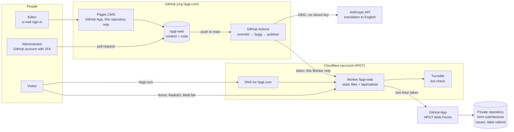
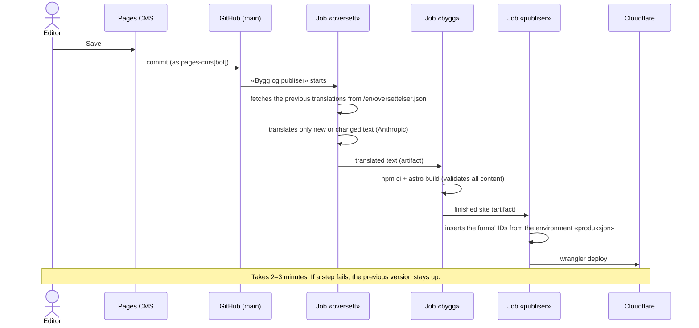
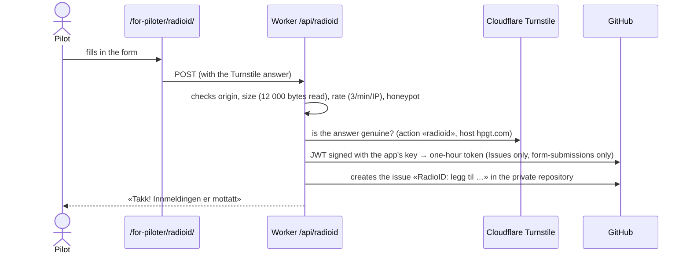

# Architecture

How hpgt.com is put together, so that more than one person can understand, run and develop it. Day-to-day operations,
accounts and routines are in [operations.md](operations.md). The security measures are in
[SECURITY.md](../SECURITY.md).

## In short

- **No server, no database.** The site is finished HTML files built from text files (Markdown and JSON) in this
  repository. All content and all history are in Git.
- **Members write in Pages CMS** (app.pagescms.org), a web-based editor that saves straight to the repository. They do
  not need a GitHub account.
- **GitHub Actions builds and publishes** every time `main` changes: it translates new text to English, builds the site
  and uploads it to Cloudflare.
- **Cloudflare serves the site** (Workers static assets). The only server code is the two forms (RadioID and «Meld feil»).
- **No tracking, no cookies, no third-party scripts** (except Turnstile on the RadioID page).

## Overview



The flying site guide **flysteder.hpgt.com** is a separate site in the repository
[hpgt-com/flying-sites](https://github.com/hpgt-com/flying-sites), with its own documentation (`docs/architecture.md`
and `docs/operations.md` there). The club site links to it, but they share no code.

## From «Save» to a published page



The three jobs are separated on purpose (`.github/workflows/deploy.yml`; the job names are Norwegian: translate,
build, publish):

| Job | Has access to | Runs code from the repository? |
|---|---|---|
| `oversett` | A short-lived sign-in at Anthropic (environment `oversetting`) | Only the translation script, not the site's packages |
| `bygg` | No secrets | Yes (npm packages and the build) |
| `publiser` | The Cloudflare token (environment `produksjon`) | No, only Wrangler, installed from `deploy/package-lock.json` without install scripts |

Pull requests (also from administrators) are built and checked by `pr-check.yml` and `security.yml` before they can be
merged, but are not published.

## Content: what lives where

| Content | File or folder | Edited in |
|---|---|---|
| News, minutes, events | `src/content/innlegg/YEAR/*.md` | Pages CMS |
| Fixed pages (For piloter, Klubben …) | `src/content/sider/*.md` | Pages CMS |
| Competitions | `src/content/sider/konkurranser/YEAR.md` | Pages CMS |
| Course pages | `src/content/kurs/*.md` | Pages CMS |
| Home page, board, RadioID register | `src/data/forside.json`, `styret.json`, `radioid.json` | Pages CMS |
| Default images per category | `src/data/standardbilder.json` | Pages CMS |
| Images and PDFs | `public/media/…` (see the README) | Pages CMS (upload) |
| Menus, site settings | `src/data/meny.json`, `site.json` | Pull request only |
| Design | `src/design/` (`style.css`, templates), `src/components/` | Pull request only |
| Redirects from old addresses | `astro.config.mjs`, `public/_redirects` | Pull request only |

Every field is validated by `src/content.config.ts`. An invalid value from the CMS stops the build instead of
publishing a broken page. Which fields editors see is set by `.pages.yml`. Fields not listed there are removed when
someone saves, which is why some fields have `hidden: true`.

## English version

The pages in `SIDER` in `scripts/oversett/oversett.mjs` (courses, for pilots, the club pages and so on) are translated
automatically on every publish. Unchanged text is reused from the previous publish (`/en/oversettelser.json`), so only
new or changed paragraphs are sent to Anthropic. English addresses (`/klubben/styret/` → `/en/club/board/`) are in
`src/lib/engelske-adresser.mjs`, and fixed texts (menus, buttons) in `src/lib/i18n.ts`.

News and events are translated too (`/en/news/`, `/en/events/`, and each post at `/en/<address>/`), except meeting
minutes, which are formal documents for members and stay in Norwegian. Each English post says it was translated
automatically and links to the Norwegian original. A post without a translation (minutes, or one that failed) is listed
on the English pages with its Norwegian title and «(in Norwegian)».

If the sign-in at Anthropic fails, the site is still published, with the previous translations.

## The forms (RadioID and «Meld feil»)



The issues are in the private repository `hpgt-com/form-submissions`, since they hold names, RadioIDs and comments,
including requests to be removed. Whoever maintains the register updates `radioid.json` in Pages CMS (only the finished
entry is published) and closes the issue. The code is
`worker/index.js` and `worker/github-app.js`.

The second form, **«Meld feil»** (report an error, `/meld-feil/` and `/en/report-error/`, linked from the bottom of every
page), works the same way: `/api/meld-feil`, Turnstile action `meldfeil`, and an issue with the label `feedback` in the
same private repository. New forms use the same Turnstile widget with their own `action`.

## Security in brief

- **Least privilege everywhere.** Each token can do only the one thing it is for: publish one Worker, create issues in
  one repository, read one R2 archive. No personal tokens.
- **No stored keys where it can be avoided.** Translation signs in with GitHub's OIDC token. The forms get a
  new token for each submission.
- **Secrets only in environments that `main` alone may use** (GitHub) or in Cloudflare, never in the code.
- **Everything goes through a pull request** with required checks (build, dependencies, workflow security, CodeQL).
- **Strict CSP** without `unsafe-inline`, and no third-party scripts.

Details: [SECURITY.md](../SECURITY.md).

## Repository layout

```
.github/workflows/   build, publishing, PR checks, security scanning
.pages.yml           what editors see in Pages CMS
astro.config.mjs     Astro setup and redirects
docs/                this documentation
public/              files published as they are: images, scripts, _headers, _redirects, robots.txt
scripts/             translation, video thumbnails, image scaling, sitemap, WordPress import (one-off)
settings/            org and repository settings that cannot live in the repository (applied by an org owner)
src/content/         the content (Markdown)
src/data/            content and settings (JSON)
src/design/          the «Fjord+» design
src/components/      reusable parts
src/lib/             helpers (links, language, sections)
src/pages/           the addresses (Astro routes)
worker/              the server code for the form
wrangler.jsonc       Cloudflare setup
```

## Why these choices

Each is described as an ADR in [decisions/](decisions/README.md). In short:

- **A static site**: nothing to update or attack on a server, nearly free, and fast.
- **Astro**: validates the content, the templates are plain HTML and JavaScript, and it builds in seconds.
- **Pages CMS**: the only CMS where members can sign in with e-mail without a GitHub account, and where e-mail users can
  change content only.
- **Cloudflare**: free for our use, DNS and the website in one place, and Turnstile without tracking.
- **GitHub**: history, review and automation in one place, free for public repositories.
